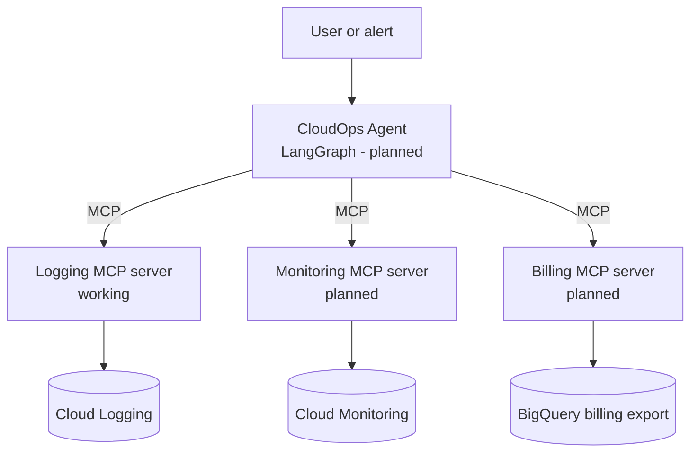

# CloudOps Agent

An AI agent that diagnoses Google Cloud incidents and explains cost spikes, using custom [MCP](https://modelcontextprotocol.io) servers for Cloud Logging, Cloud Monitoring and billing data.

The goal is not just a demo. The project will include an evaluation set of deliberately broken deployments, so the agent's **root-cause accuracy** can be measured and compared against a simple baseline.

> **Status:** early development. The Cloud Logging MCP server works today; the agent, other tools and evals are in progress. See the [roadmap](#roadmap).

## Why

Diagnosing a cloud incident usually follows the same loop: check the metrics, read the logs, line them up with recent changes, and explain the root cause. CloudOps Agent automates that loop with an LLM that can call tools, and is built so every claim it makes can be checked against the evidence (log entry IDs, metric series).

## Architecture



During development, the MCP servers are tested with the MCP Inspector and Claude Desktop over the **stdio** transport. For deployment they will run on Cloud Run over **Streamable HTTP**.

## What works today

**Logging MCP server** (`src/cloudops_agent/mcp_servers/logging_server.py`)

| Tool | What it does |
|---|---|
| `get_recent_errors(minutes, max_results)` | Returns log entries with severity ERROR or worse from the last N minutes, newest first |

Design choices:

- **Inputs are clamped** (up to 7 days, up to 100 entries), so a model can't trigger huge, slow or expensive queries.
- **All times are UTC**, avoiding time-zone bugs between log timestamps and query windows.
- **Every result includes the log entry's `insert_id`**, so the agent can cite evidence and the evals can check those citations.
- **No credentials in code.** Authentication uses Application Default Credentials; the project ID comes from the `GOOGLE_CLOUD_PROJECT` environment variable.

## Roadmap

- [x] Project setup (uv, src layout, GitHub)
- [x] Logging MCP server with `get_recent_errors`
- [x] Tested with MCP Inspector and Claude Desktop
- [ ] More logging tools (search by service, top errors with counts)
- [ ] Monitoring MCP server (latency, error rate, restarts)
- [ ] Fault-injectable demo app on Cloud Run (bad deploys, memory leaks, timeouts, cost spikes)
- [ ] Recorded incident set with ground-truth labels (record/replay for offline evals)
- [ ] LangGraph agent: triage, investigate, hypothesise, verify, report
- [ ] Evals: root-cause accuracy vs. a single-prompt baseline, across models
- [ ] Billing MCP server (BigQuery export)
- [ ] FastAPI service on Cloud Run, eval-gated CI

## Run it locally

**Prerequisites:** Python 3.13+, [uv](https://docs.astral.sh/uv/), the [gcloud CLI](https://cloud.google.com/sdk/docs/install), Node.js (for the MCP Inspector), and a Google Cloud project with the Logging API enabled.

```bash
git clone https://github.com/sid-510/cloudops-agent.git
cd cloudops-agent
uv sync

gcloud auth application-default login
export GOOGLE_CLOUD_PROJECT=your-project-id
```

Test the server in the MCP Inspector:

```bash
npx @modelcontextprotocol/inspector \
  -e GOOGLE_CLOUD_PROJECT=your-project-id \
  uv run python src/cloudops_agent/mcp_servers/logging_server.py
```

To use it from Claude Desktop, add this to `claude_desktop_config.json` (use the output of `which uv` for `command`):

```json
{
  "mcpServers": {
    "cloudops-logging": {
      "command": "/path/to/uv",
      "args": [
        "run", "--directory", "/path/to/cloudops-agent",
        "python", "src/cloudops_agent/mcp_servers/logging_server.py"
      ],
      "env": { "GOOGLE_CLOUD_PROJECT": "your-project-id" }
    }
  }
}
```

## Project structure

```
cloudops-agent/
├── src/cloudops_agent/
│   └── mcp_servers/
│       └── logging_server.py   # Cloud Logging MCP server
├── scripts/
│   └── read_logs.py            # exploration script
├── pyproject.toml
└── uv.lock
```

## Tech stack

Python 3.13, uv, MCP Python SDK (v2), Google Cloud Logging. Planned: LangGraph, LangSmith, FastAPI, Docker, Cloud Run, pytest, GitHub Actions.

## Author

Siddhesh Sampakal: AI engineer, MSc Computer Science (AI) at University of Galway, previously AI Engineer and Cloud Support Engineer for Google Cloud AI products at Cognizant.
